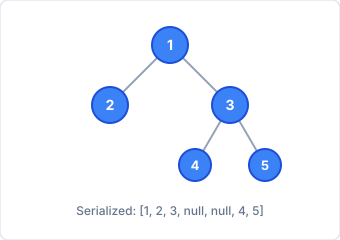

Implement an algorithm to serialize and deserialize a binary tree.

Serialization is the process of converting an in-memory structure into a sequence of bits so that it can be stored or sent across a network to be reconstructed later in another computer environment.

You just need to ensure that a binary tree can be serialized to a string and this string can be deserialized to the original tree structure. There is no additional restriction on how your serialization/deserialization algorithm should work.

**Note:** The input/output format in the examples illustrates a level-order serialization format where null represents absent child nodes. You do not necessarily need to follow this exact format as long as deserialize(serialize(root)) reconstructs the original tree.

**Example 1:**



```
Input: root = [1,2,3,null,null,4,5]

Output: [1,2,3,null,null,4,5]
```

**Example 2:**

```
Input: root = []

Output: []
```

**Constraints:**
* `0 <= The number of nodes in the tree <= 10,000`.
* `-1000 <= Node.val <= 1000`


