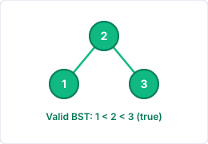
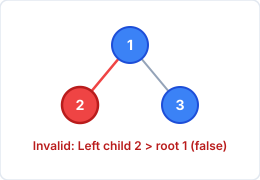

Given the `root` of a binary tree, return `true` if it is a **valid binary search tree**, otherwise return `false`.

A **valid binary search tree** satisfies the following constraints:    
* The left subtree of every node contains only nodes with keys **less than** the node's key.
* The right subtree of every node contains only nodes with keys **greater than** the node's key.
* Both the left and right subtrees are also binary search trees.

**Example 1:**



```
Input: root = [2,1,3]

Output: true
```

**Example 2:**



```
Input: root = [1,2,3]

Output: false
```

Explanation: The root node's value is 1 but its left child's value is 2 which is greater than 1.

**Constraints:**
* `1 <= The number of nodes in the tree <= 10000`.
* `-1000000000 <= Node.val <= 1000000000`


